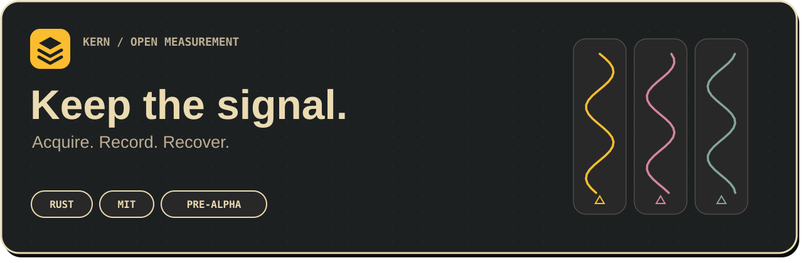

<p align="center"><strong>English</strong> · <a href="README.ru.md">Русский</a></p>



# KERN · Керн

**Independent drilling measurement recording. A small Rust core, replaceable plugins and preserved measurements.**

The first core slice 0.1.0 and a separate native Windows shell with menus, settings and package management are implemented: a separate process, raw-batch validation, CRC journal with disk acknowledgements, recovery, status and freshness settings. Hardware sources, the interpreter and working formats connect as separate components; the mandatory recovery journal keeps recording inputs when calculations or the interface fail.

[Plain-language core guide](docs/en/CORE_GUIDE.md) · [Validation](docs/en/CORE_VALIDATION.md) · [Architecture](docs/en/ARCHITECTURE.md) · [Stages and acceptance](docs/en/ROADMAP.md) · [Style](docs/en/BRANDING.md) · [Material provenance](docs/en/MATERIALS.md)

| Component | Responsibility |
|---|---|
| Core | Channels, parameters, quality, configuration versions, journal and supervision |
| Source plugins | Their own hardware protocol; one COM port per instance |
| Interpreter | Raw inputs → parameters using historical calibration maps |
| Recording plugins | Working files, export and an additional backup copy |
| System shell | Mandatory separate process: menus, settings and status |
| Charts | Replaceable presentation; rendering load does not set acquisition frequency |

**Status: first pre-alpha desktop slice.** 26 Rust tests, 17 im2480 checks and earlier 18 raw scenarios / 14 shell checks on Windows11: UI crash/hang does not interrupt recording; normal closure does not respawn. Interpreter/maps/physical-device acceptance, a general SDK, endurance and weak-hardware acceptance remain ahead. [Packages and supervision](docs/en/PLUGINS.md).

Build: `cargo build --workspace --release --locked`. Run `target/release/kern-core.exe serve --profile runtime/first-test`, then `target/release/kern-demo.exe --profile runtime/first-test` in another window. `python tools/package_core.py` creates a local bundle with CMD launchers in `dist/Kern-Core-0.1.0/`.

At the owner's request, a detailed core guide explains the system for non-specialists; changing-UI help remains deferred until alpha. The shell is connected: run `Start-Kern.cmd` after packaging; `Start-Core.cmd` remains headless. An operator web widget builder without programming is separately planned; critical plugins remain Rust. The three-layer mark and Ember/Gruvbox are approved; full styling remains ahead. [Dependencies and notices](docs/en/DEPENDENCIES.md).


The first COM plugin **im2480** is connected: a separate process, six channels per module, CRC checks and independent missing data. The local bundle includes `plugins/im2480`; [contract and validation](docs/en/IM2480.md). Physical hardware is not accepted yet.

```powershell
python tools/project_context.py start core
python tools/docs_sync.py check
python tools/project_context.py check
python -m unittest discover -s tests -v
```

The tools need Python 3.10+ and Git, with no pip dependencies. Open the repository root as an Obsidian vault. Russian originals and English translations share one branch.

[MIT](LICENSE) · [Working rules](AGENTS.md) · [Source](https://github.com/bubinbei/kern)
