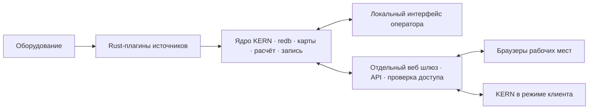

# Сервер, рабочие места и общий веб интерфейс

Статус: утверждённая цель дальнейшего развития от 2026-10-23. **Сетевые рабочие места и удалённое управление сейчас не реализуются.** Локальный [прототип](PROTOTYPE.md) реализует выбранные части этапов из [STORAGE_CHARTS_PLAN](STORAGE_CHARTS_PLAN.md). Этот документ задаёт границы заранее, чтобы локальный интерфейс не пришлось разрабатывать заново для каждого рабочего места.

## Один сервер измерений, несколько представлений

Схема целевая: redb/интерпретатор уже включены в локальный прототип, сетевой шлюз ещё не реализован. Расчёт и запись выполняют отдельные плагины под надзором ядра, а не один общий процесс. Локальный путь интерфейса сохраняется при отказе шлюза.

**Сервер KERN** — узел на буровой, владеющий оборудованием, тремя логическими наборами данных, историей, версиями настроек и процессами источников/интерпретатора/писателей. Он работает без открытых клиентов и без интернета. redb остаётся локальной базой сервера; по сети передаётся API, а не файл базы или доступ к COM.

**Рабочее место** — браузер либо KERN в режиме клиента. Оно подключается к выбранному серверу, получает разрешённые параметры/историю/качество и рисует графики. В клиентском режиме не запускаются источники COM, собственный авторитетный интерпретатор или запись серверного профиля. Необязательный локальный кэш отображения не становится источником истины. Адрес сервера и идентификатор объекта видны оператору; смена сервера очищает привязанные к прежнему серверу курсоры/кэши.

**Локальный оператор** тоже использует клиентский контракт. Нативная минимальная оболочка остаётся доступной при внедрении веб представления. Ответственная регистрация не зависит от WebView, окна или сетевого шлюза.

## Переиспользование веб компонентов

Одна общая веб библиотека экранов/виджетов, включая uPlot, предназначена для локального веб представления, браузерных рабочих мест и desktop-клиента. Меняются подключение и выданные права; значения, версии, качество, диапазонное чтение и действия используют общий версионированный контракт. Транспорт локального bridge может отличаться от сетевого. Удалённая команда проходит ту же проверку состояния ядром, что и локальная.

В веб слое остаются компоновка, графики, формы, фильтры и персональные настройки вида. Калибровка, авторитетные результаты, приём оборудования, обязательный журнал и восстановление остаются Rust. Клиентский предпросмотр формулы не заменяет подтверждённый расчёт сервера. Настройки вида пользователя хранятся отдельно от общих карт калибровки; изменение масштаба/цвета не изменяет измерения всем участникам.

Веб шлюз — отдельный устанавливаемый/включаемый компонент, а не часть обязательного цикла приёма. Он переводит внешний протокол в ограниченный API ядра и может быть перезапущен независимо. Нельзя публиковать существующий локальный IPC с общим токеном в LAN/интернет: нынешний IPC рассчитан на доверенные локальные программы. Разделение полномочий нужно реализовать до сетевой поставки. Шлюз, host и протокол не выбраны этим документом.

## Рабочие места и права

| Профиль | Целевое поведение |
|---|---|
| Оператор ГТИ | Локальный просмотр, настройка источников/датчиков и калибровок в рамках выданных прав |
| Супервайзер, мастер | Просмотр разрешённых параметров, истории и состояния, собственная компоновка |
| Растворный сервис | Своё представление нужного набора параметров и истории |
| Наклонно-направленное бурение | Свои графики/параметры и временные интервалы |
| Представитель заказчика | Ограниченный просмотр выбранного объекта через интернет |
| Офисный сервис | Отдельно разрешённая сессия управления сервером, способная временно заменить оператора |

Это стартовые профили, не жёстко зашитые должности. Права задаются действиями и областью: объект/сервер, каналы/параметры, история/экспорт, изменение карт, настройка источников, управление процессами. По умолчанию удалённое рабочее место получает только просмотр. Возможности установки/обновления плагинов и остановки всего сервера выдаются отдельно от права калибровать.

Проверку выполняет сервер, независимо от скрытых/видимых кнопок клиента. Личность и разрешения привязаны к проверенной сессии; текстовое поле `role` из запроса не даёт полномочий. Каждый пользователь имеет собственную сессию, которую можно отозвать. Для представителя заказчика не отправляются скрытые от него каналы, сырые входы или служебные карты только потому, что они доступны самому шлюзу.

## Сервисный режим и управление без конфликтов

Сервисный режим — авторизованные команды через API, а не удалённый рабочий стол. Удалённый специалист видит состояние, меняет разрешённые настройки и получает подтверждённый результат. Переподключение клиента не считается новой командой.

Для операций, влияющих на общую конфигурацию, сервер выдаёт ограниченное по времени право управления: владелец, область и номер поколения. В одной области действует один управляющий; параллельный просмотр разрешён всем допущенным клиентам. Локальный оператор видит владельца управления и может вернуть управление по политике сервера. Отзыв/истечение/перезапуск сервера меняет поколение: команды прежнего владельца отвергаются. Принятая до отзыва операция имеет явный результат в журнале; уже подтверждённые изменения не отменяются молча.

Команда несёт request ID, ожидаемую версию настроек, действующую сессию/полномочие и ограниченный срок исполнения, проверяемый сервером. Повтор имеет один эффект. Старая версия требует перечитывания состояния; поздний запрос после обрыва не применяется автоматически. При неизвестном исходе клиент запрашивает результат по request ID, а не повторяет изменение с новым ID. Нужные сведения об обработке/дедупликации сохраняются для согласованного восстановления.

Серверный аудит сохраняет кто, откуда и в какой сессии отправил команду, её ID, основание полномочий, прежнюю/новую версию и результат. Секреты/пароли в измерительный журнал не пишутся. Действует прежний протокол карт: saved → loaded → activated; сообщение «отправлено» не означает «применено». Для калибровки видна точная граница активации. Учётные записи и способы входа выбирать на готовых поддерживаемых решениях при реализации сетевого этапа.

## Сеть и слабое железо

- Клиент сначала получает согласованный snapshot с позицией, затем изменения; история запрашивается порциями по нужным каналам и интервалу. В ответах есть идентификаторы сервера/объекта, эпоха потока и версия схемы; несовместимость или смена эпохи требуют явной пересинхронизации.
- При обрыве экран показывает потерю связи и возраст последнего отсчёта. Последнее известное значение не выдаётся за свежее и не заменяется нулём. После подключения клиент догоняет доступный диапазон либо получает новый snapshot и явное сообщение о недоступной истории. На диске сервера сбор не останавливается.
- Число клиентов, частота обновлений, размер запросов, очереди, кэш и стоимость истории ограничены. Объединяются промежуточные экранные обновления, а не архивные отсчёты. Медленный клиент получает пересинхронизацию или отключается; его просмотр не удерживает историю сервера бессрочно и не задерживает приём. Это другой договор, чем у обязательного писателя/backup.
- История и подготовка экранных данных имеют меньший приоритет, чем приём/фиксация измерений. Нельзя создавать новый опрос COM/полный пересчёт на каждого зрителя. Тяжёлые чтения разбиваются на короткие транзакции; проверяется нагрузка на один общий сервер при нескольких клиентах, а не только на каждом экране.
- Веб части работают с локально поставляемыми ресурсами, без CDN. Интернет-доступ добавляется через контролируемый шлюз с шифрованием и аутентификацией/правами, а не публикацией базы/COM/локального административного IPC. Конкретный транспорт, TLS-компонент и способ доступа выбираются отдельным этапом. Внешние порты/маршруты/слушатели не открываются; локальный bridge прототипа не является LAN-шлюзом.

## Постепенное внедрение

| Этап | Результат | Приёмка |
|---|---|---|
| N0 — проектирование сейчас | Общие DTO/ID/версии/качество, отделение клиентского вида от серверных правил; учитывать в R1–R4 | Контракт не требует общей памяти/локальных файлов у клиента; внешних слушателей нет, только локальный IPC/bridge |
| N1 — после рабочего локального среза | Общие веб экраны и локальный адаптер; uPlot переиспользуется | Отказ экрана оставляет приём/запись; native-диагностика доступна; одинаковые значения/разрывы/флажки |
| N2 — LAN, только просмотр | Шлюз, аутентификация, ограниченные права, браузер и desktop-клиент | Нет записей от read-only; скрытые каналы не уходят по сети; reconnect/эпохи; несколько клиентов, слабый сервер и медленный клиент |
| N3 — интернет-просмотр | Ограниченный доступ заказчика через защищённую точку входа | Границы объектов/пользователей, отзыв сессий, лимиты, разрыв внешней сети без влияния на регистрацию |
| N4 — офисный сервис | Делегирование/отзыв управления, серверный аудит, идемпотентные команды | Конфликт двух операторов, локальный перехват, истечение права, поздняя команда, потеря ack, restart сервера/шлюза, активация карт и неизменность raw |

Веб конструктор W1 и пользовательские плагины развиваются поверх этих контрактов отдельно. Роль «клиент» не даёт веб компоненту произвольный доступ к серверу или возможность загружать код в ядро. Сетевой roadmap не добавляет новые платформы в текущую приёмку Windows; macOS остаётся поздним этапом. Масштаб, бюджеты и готовность оцениваются испытаниями, а не обещанием, что веб автоматически дешевле нативного UI.
