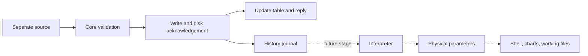

# KERN core: a guide without specialist prerequisites

Version 0.1.0 provides a command-line core, a separate synthetic source and a native Windows shell with menus/settings/package management. The first COM source [im2480](IM2480.md) is connected. The first end-to-end prototype adds redb, a calibration interpreter, uPlot charts, CSV and backup: [launch and contract](PROTOTYPE.md). The explanation below retains the basic raw/KJN slice; physical hardware is not accepted yet. [Verified results and limits](CORE_VALIDATION.md).

## What the core is

Think of a dispatcher keeping a log. Instruments send readings. The dispatcher checks their owner, channel and sequence, saves them, and only after disk confirmation replies “Saved.”

The latest-value table is a display board; the journal is a history tape. The board cannot reconstruct the tape. The core maintains both.



Solid arrows are implemented. Dotted arrows are future stages. A raw number is not converted into tonnes without a map; the physical-parameter table is intentionally empty.

## Starting it

The locally built bundle is `dist/Kern-Core-0.1.0/`:

1. `Start-Core.cmd` starts the core and keeps its console open.
2. `Run-Demo.cmd` sends 100 synthetic six-channel batches in another console.
3. `Status.cmd` displays status.
4. `Stop-Core.cmd` shuts down normally.

These use their own `data/default` profile inside the bundle. DEMO opens no real device or COM port. Use normal shutdown rather than closing the core console with its window button; closing it is a process interruption.

To build from source, open PowerShell at the repository root:

```powershell
cargo build --workspace --release --locked
.\target\release\kern-core.exe serve --profile .\runtime\first-test
```

Leave that window running. `READY` means the journal was loaded, a new boot was recorded and commands can be accepted. In a second PowerShell:

```powershell
.\target\release\kern-demo.exe --profile .\runtime\first-test --id demo-1 --channels 6 --count 100 --period-ms 100
.\target\release\kern-core.exe status --profile .\runtime\first-test
.\target\release\kern-core.exe snapshot --profile .\runtime\first-test
```

Use the same profile path in every command. A profile is one core's directory containing journal, settings and service metadata. A second core cannot own the same profile; another profile is allowed.

## Understanding the numbers

DEMO generates **synthetic integers**, not physical readings. Formula: `seed + batch_sequence × 100 + channel`, with default seed 1000. The first batch is 1100–1105; batch 100 is 11000–11005. This gives an independently checkable reference.

A fresh profile ends with `raw_batches: 100` and `raw_samples: 600`. Running again adds history instead of resetting it. When DEMO finishes it closes its session: `active_sources` becomes 0 and values remain with `disconnected` quality. This is normal source completion, not data loss.

Output is currently JSON: names on the left, values on the right.

| Field | Meaning |
|---|---|
| `boot` | This profile's boot number |
| `event_sequence` | Last disk-confirmed event position, including settings/connections |
| `raw_batches` / `raw_samples` | Saved packets / individual readings |
| `source_count` / `active_sources` | Reserved sources / open sessions; an open session alone does not imply fresh data |
| `pending_write` | A write still lacks disk confirmation |
| `disk_error` | Storage error; `null` means none has been detected |
| `catalog_revision` | Source catalog version, changed when opening/updating source definitions |
| `settings_revision` | Core-settings version |
| `interpreter_connected` / `shell_connected` | Currently `false`; these components do not exist yet |

`snapshot` shows channel values. `parameters: []` is the intentionally empty physical-parameter table, not a raw-reading failure.

## Quality matters

| Quality | Meaning |
|---|---|
| `good` | Source reports a valid reading within its freshness deadline |
| `bad` | Source marks the reading invalid |
| `missing` | No value, or an explicit missing reading |
| `stale` | Value remains but has not been refreshed recently |
| `disconnected` | Source session was closed normally |
| `recovered` | Value was loaded from history after boot, not measured anew |

Equal values can be separate measurements. A new sequence carrying 1000 refreshes that channel; silence does not create invented 1000 samples. Freshness is per channel, so updating one does not refresh its neighbors.

Measurement and receipt times are separate. Freshness uses monotonic process time, so changing system time cannot prolong a reading's life. Old values become `recovered` after restart.

## Stable channels

Each source reserves 100 addresses but sends only occupied channels. With 18 channels in one source and 20 in another, adding 6 to the first leaves the second's addresses unchanged. The initial limit is 10 sources. IDs are not renumbered and disconnected slots are not automatically reused.

The source name is its stable ID, `session` identifies a connection, and `sequence` identifies a batch within that session. An old process cannot submit into a new connection. Repeating the exact latest batch is acknowledged without another write; the same sequence with different contents is rejected. A skipped sequence is explicit. Older repeats are not inserted again or accepted as new data.

A connection resource has one owner. This version checks logical resource ownership; actual COM and automatic hardware-plugin management are future work.

If DEMO is closed before normal completion, the core does not guess whether another process may take its name: values become stale and reopening returns resource_busy. Read the current session in snapshot and close it explicitly. For example, only if session is 1:

```powershell
.\target\release\kern-core.exe close --profile .\runtime\first-test --source demo-1 --session 1
```

Alternatively, stop/restart the core normally: saved data remains and old sessions close. Automatic source supervision will be added separately.

## Changing settings safely

The current setting is the channel staleness threshold. Read `settings_revision`; it starts at 0:

```powershell
.\target\release\kern-core.exe settings --profile .\runtime\first-test --expect-revision 0 --stale-ms 2000
```

The core validates, journals and confirms version 1. If another client already changed it, version 0 conflicts instead of silently overwriting newer settings. Read the current state and deliberately retry with its revision.

The range is 100–3,600,000 ms. This controls freshness, not acquisition or recording frequency. Calibration maps and their separate activation boundaries come with the interpreter.

## Shutdown, checking and recovery

Normal shutdown is journaled:

```powershell
.\target\release\kern-core.exe stop --profile .\runtime\first-test
.\target\release\kern-core.exe check --profile .\runtime\first-test
.\target\release\kern-core.exe dump --profile .\runtime\first-test
```

`check` validates the journal. `dump` streams one JSON Lines event at a time rather than loading all history. These operations and recovery copying require the core to be **stopped**; the profile lock excludes concurrent writing.

An incomplete last record is preserved in its original file. The core reads intact records and starts a new segment with a recovery boundary. A complete record with a bad checksum stops normal startup: already saved data may be damaged, so this cannot be silently treated as a normal tail.

CRC is a check number calculated from record contents. Changed bytes normally change it and are detected on reading. The journal prefix means all intact records from the beginning up to the first damaged record; this is what can be copied separately.

Copy only the intact history prefix into a **new** directory:

```powershell
.\target\release\kern-core.exe recover --profile .\runtime\first-test --output .\runtime\recovered-copy
.\target\release\kern-core.exe check --profile .\runtime\recovered-copy
```

The destination must not exist. Original files remain unchanged. Damaged and subsequent records are not guessed; prefix recovery does not promise all data. Some structural failures, such as a missing segment or an interruption of the recovery boundary itself, still require separate investigation and may be refused even by this command. Keep the original.

## Storage failure

A separate thread performs writes. The dispatcher can answer status while storage is busy. Table changes become visible only after successful `sync_all` and writer acknowledgement. A timed-out reply is uncertain: the batch may already be saved. Retry the **same** batch/sequence, not a newly invented one.

A storage failure sets `disk_error`; new changes are not acknowledged or accumulated without bounds. Existing values keep aging. Stop remains available but reports the disk error instead of falsely confirming a new saved shutdown event. Inspect storage/journal before restarting; automatic clearing is not implemented.

Limits: 64 queued commands, one pending write, 16 network workers, 64 KiB requests and 512 KiB snapshots. Busy clients retry. Bounded memory cannot provide unlimited ingestion while storage is broken.

Segments are at most 4 MiB, with 4096 segments allowed. Each boot starts another segment. Automatic deletion/compression is not implemented; reaching the limit stops recording explicitly. `sync_all` asks the OS to persist data; it is not proof against every power/controller failure. Storage-hardware acceptance is outstanding.

## The first menu is connected

`Start-Kern.cmd` in the local bundle starts the core and a separate native window with menus, status, freshness setting and package list. Select the synthetic source and start it; stop ends that source. Closing the window keeps the core running; reopen using `kern-core shell --profile PATH`. Full KERN shutdown is separate. The CLI/headless commands above remain valid.

A package is a directory containing `plugin.json` and an `.exe`; copying never launches code. See [PLUGINS](PLUGINS.md) for the contract/supervision/limits and separate operator web-environment plan. Subscriptions, interpreter and general SDK remain ahead.
