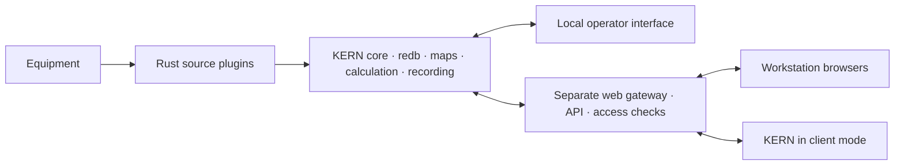

# Server, workstations and a shared web interface

Status: future-development target approved on 2026-10-23. **Network workstations and remote control are not being implemented now.** R1 from [STORAGE_CHARTS_PLAN](STORAGE_CHARTS_PLAN.md) remains the next working slice. This document establishes boundaries early so the local interface need not be rebuilt for every workstation.

## One measurement server, multiple presentations

This is a target diagram: redb/interpreter/gateway are not included in the current build. Calculation and recording run in separate plugins supervised by the core, rather than one shared process. The local interface path remains available if the gateway fails.

**KERN server** is the rig node owning equipment, the three logical datasets, history, configuration versions and source/interpreter/writer processes. It works without open clients or internet access. redb remains a local server database; the network exposes an API, not the database file or COM access.

**A workstation** is a browser or KERN in client mode. It connects to a selected server, receives authorized parameters/history/quality and renders charts. Client mode does not launch COM sources, its own authoritative interpreter or server-profile recording. An optional local display cache never becomes authoritative. Server address and site identity are visible; switching servers clears cursors/caches associated with the previous server.

**The local operator** also uses the client contract. Retain the minimal native shell while introducing web presentation. Critical recording does not depend on a WebView, window or network gateway.

## Reusing web components

One shared web screen/widget library, including uPlot, serves local web presentation, browser workstations and the desktop client. Connections and granted permissions differ; values, revisions, quality, range reads and actions use a shared versioned contract. Local bridge transport may differ from network transport. Remote commands undergo the same core state validation as local commands.

The web layer handles layout, charts, forms, filters and personal view settings. Calibration, authoritative results, equipment acquisition, mandatory journaling and recovery remain Rust. A client-side formula preview does not replace a confirmed server calculation. User view settings are separate from shared calibration maps; changing scale/color does not change everyone's measurements.

The web gateway is a separately installable/enabled component, outside the mandatory acquisition cycle. It translates the external protocol into the restricted core API and can restart independently. Do not publish existing local IPC with its shared token to LAN/internet: current IPC assumes trusted local programs. Implement permission separation before network distribution. This document does not select the gateway, host or protocol.

## Workstations and permissions

| Profile | Target behavior |
|---|---|
| GTI operator | Local viewing, source/sensor setup and calibration within granted permissions |
| Supervisor, rig master | Authorized parameters, history and status; personal layouts |
| Drilling-fluid service | A tailored view of relevant parameters and history |
| Directional drilling | Its own charts/parameters and time ranges |
| Customer representative | Restricted viewing of a selected site over the internet |
| Office service | A separately authorized server-control session able to temporarily replace the operator |

These are initial profiles, not hard-coded occupations. Permissions specify actions and scope: site/server, channels/parameters, history/export, map editing, source setup and process management. Remote workstations default to viewing only. Plugin installation/updates and full-server shutdown are separate from calibration permission.

The server enforces permissions regardless of visible/hidden client buttons. Identity and permissions belong to a verified session; a request's textual `role` field grants nothing. Each user has an individually revocable session. Hidden channels, raw inputs or service maps are not sent to a customer merely because the gateway itself can access them.

## Service mode and conflict-free control

Service mode means authorized API commands, rather than remote desktop control. The remote specialist observes state, changes permitted settings and receives confirmed outcomes. Client reconnection is not a new command.

For operations affecting shared configuration, the server grants time-limited control with an owner, scope and generation number. One controller owns a scope at a time; all authorized clients may continue viewing. The local operator sees the controller and can reclaim control according to server policy. Revocation/expiry/server restart changes the generation: commands from the previous owner are rejected. An operation accepted before revocation has an explicit journaled outcome; confirmed changes are not silently undone.

A command carries a request ID, expected configuration revision, current session/permission and a limited execution lifetime checked by the server. Retrying has one effect. An outdated revision requires rereading state; a late request after disconnection is not automatically applied. If the outcome is unknown, the client queries by request ID instead of issuing the change under a new ID. Persist the processing/deduplication information needed for coherent recovery.

Server audit retains who sent a command, from where and in which session, its ID, authorization basis, previous/new revisions and outcome. Secrets/passwords do not enter the measurement journal. The existing map protocol remains saved → loaded → activated; “sent” does not mean “applied.” Calibration exposes the exact activation boundary. Choose maintained authentication/account solutions when implementing the network stage.

## Networking and low-end hardware

- A client first receives a coherent snapshot with a position, then changes; history is fetched in chunks for selected channels/ranges. Responses carry server/site identities, a stream epoch and schema version; incompatibility or epoch change requires explicit resynchronization.
- On disconnection, the screen shows connection loss and sample age. A last-known value is neither presented as fresh nor replaced with zero. On reconnect, catch up over available history or obtain a new snapshot and an explicit unavailable-history message. Server-side recording continues.
- Bound client count, update rates, request sizes, queues, cache and history cost. Coalesce intermediate display updates, not archived samples. A slow client is resynchronized or disconnected; viewing cannot retain server history indefinitely or delay ingestion. This differs from the required writer/backup contract.
- History and screen-data preparation have lower priority than measurement ingestion/commit. Do not initiate another COM poll/full recalculation for every viewer. Split expensive reads into short transactions; measure load on the shared server with multiple clients, not only each screen separately.
- Web components use locally supplied resources without a CDN. Add internet access through a controlled gateway with encryption and authentication/permissions, rather than publishing the database/COM/local administrative IPC. Select transport, TLS component and access method in a separate stage. This task opens no ports/routes/listeners.

## Gradual implementation

| Stage | Deliverable | Acceptance |
|---|---|---|
| N0 — design now | Shared DTOs/IDs/revisions/quality, separation of client presentation from server rules; account for this in R1–R4 | Contract requires no shared memory/local files on clients; no network listeners |
| N1 — after the working local slice | Shared web screens and local adapter; reuse uPlot | Screen failure leaves acquisition/recording; native diagnostics remain; matching values/gaps/flags |
| N2 — LAN viewing only | Gateway, authentication, scoped permissions, browser and desktop client | Read-only cannot mutate; hidden channels never leave the server; reconnect/epochs; multiple clients, weak server and slow client |
| N3 — internet viewing | Restricted customer access through a protected entry point | Site/user boundaries, session revocation, quotas, external-network failure without recording disruption |
| N4 — office service | Delegated/revocable control, server audit and idempotent commands | Competing operators, local reclaim, permission expiry, late commands, lost acknowledgement, server/gateway restart, map activation and unchanged raw inputs |

The W1 web builder and user plugins evolve separately on these contracts. A “client” role does not grant a web component arbitrary server access or the ability to load code into the core. The network roadmap adds no new platforms to current Windows acceptance; macOS remains a later stage. Evaluate scale, budgets and readiness by testing, not by promising that web is automatically cheaper than native UI.
